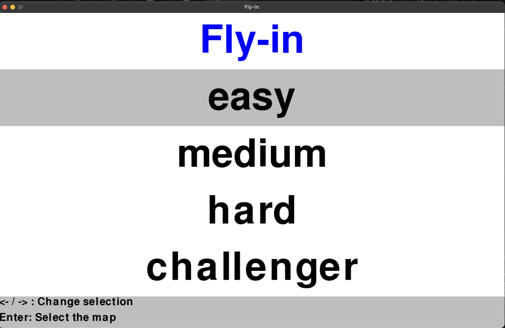
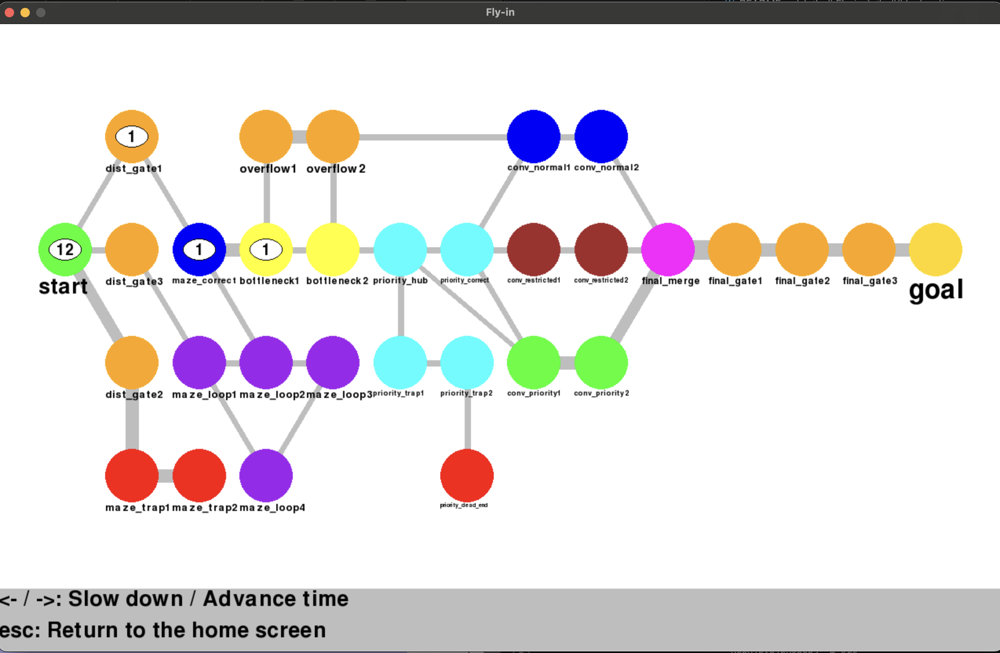
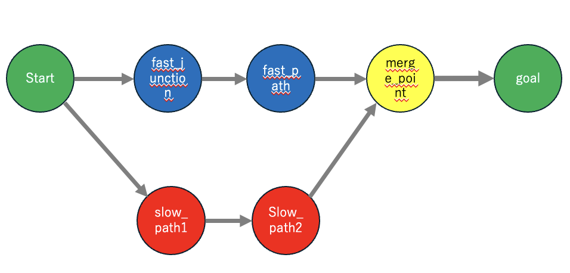
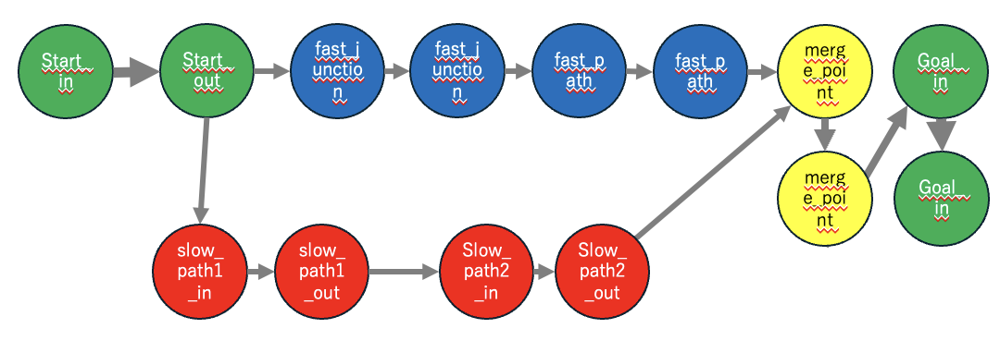
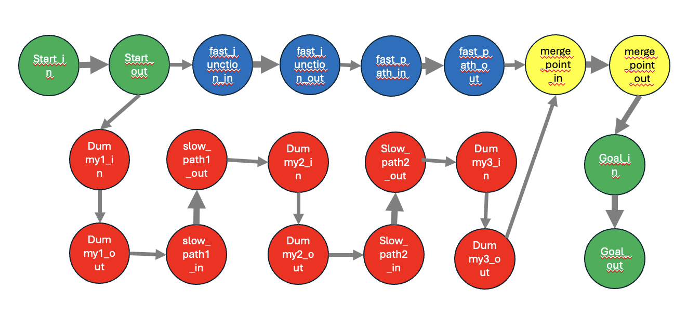
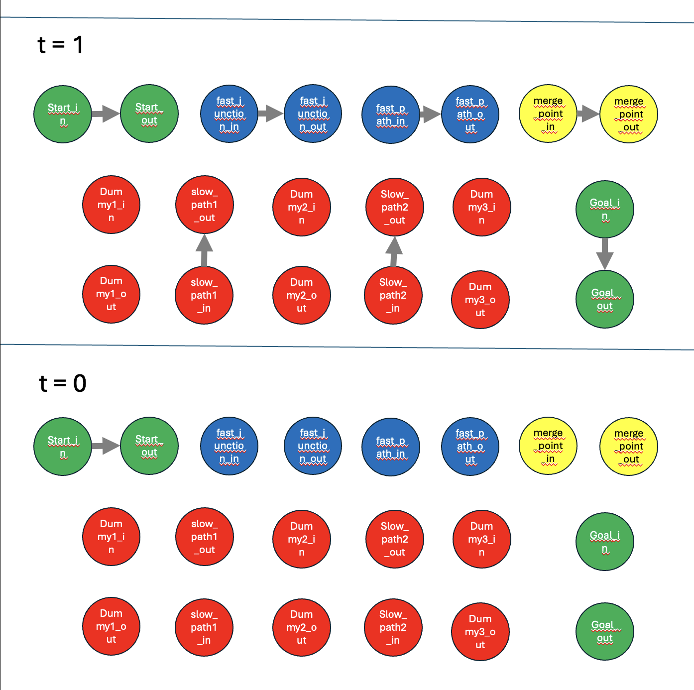
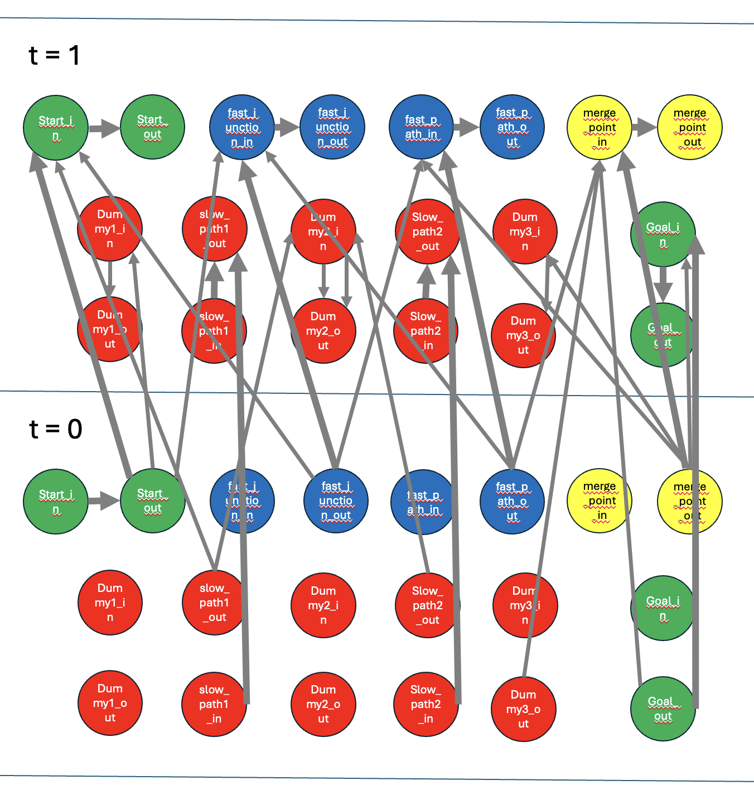
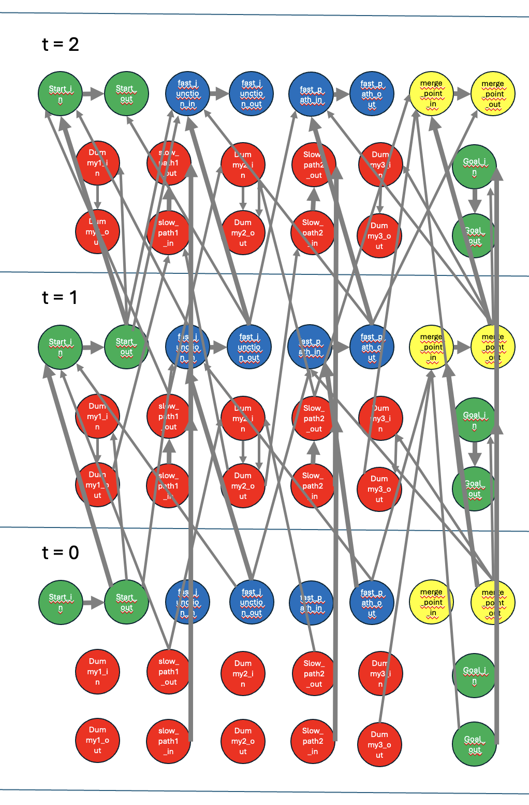
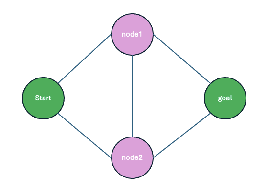

# Fly-in
## Description
*Fly-in* is a solo project for Milestone 3 of the 42 cursus. The goal is to launch multiple drones from the start at the same time and find routes that get all of them to the goal efficiently. Through it you learn about multi-agent pathfinding, maximum flow problems, and more.

### Map format
The map information is given in the following format.

```
nb_drones: 5
start_hub: start 0 0 [color=green]
end_hub: goal 10 10 [color=yellow]
hub: node 5 5[zone=restricted color=red]
connection: start-node [max_link_capacity=2]
connection: node-goal
```
The rules are as follows.
1. The first line must be `nb_drones`, which specifies the number of drones.
2. `start_hub`, `end_hub`, and `hub: name x y [metadata]` specify the hubs (nodes).
3. The hub metadata follows these rules:  
zone=type (default: normal): if the type is `normal`, the hub is a standard hub and moving to it takes 1 turn. If `blocked`, entering that zone is forbidden. If `restricted`, moving to it takes 2 turns. If `priority`, moving to it takes 1 turn and it should be routed through preferentially.  
color=value (default: none): the color of the hub.  
max_drones=number (default: 1): the maximum number of drones that can stay in the hub at the same time.
4. `connection: name1-name2 [metadata]` represents a link between the hubs name1 and name2.
5. The connection metadata follows this rule:  
max_link_capacity=number (default: 1): the maximum number of drones that can pass through that edge at the same time.

## Instruction
Follow the steps below to run the project.
```bash
# Clone from the repository
git clone https://github.com/takutotakuto1121-creator/Fly-in.git Fly-in

# Move into the repository
cd Fly-in

# Run
make run
```

A window will then open as shown below.



Select a map with the Enter key.
Once you have made your selection, the map opens as shown below, and you can advance or rewind time with the arrow keys to check the drones' behavior.



If you only want to print the log to the terminal, you can run the following command.
If ARG is not specified, `maps/hard/03_ultimate_challenge.txt` is used by default.
```bash
make log ARG=[path to map]
```

## Algorithm
### Parsing
The text file that describes the map is parsed.
Parsing is done with validation using pydantic, but since the main focus is pathfinding and visualization, I omit the details here. You can understand it quickly by reading the code.

### Time-expanded Network Flow
The implementation incorporates the concept of space-time into maximum flow. The maximum flow problem is: given a graph, find the maximum amount of water that can be sent through it. I leave the explanation to [this site](). For pathfinding, [DFS]() is used. Let me explain with a concrete example. Suppose the following map is given (the map from maps/medium/03_priority_puzzle.txt).
```
# Medium Level 3: Priority zones create optimal path challenges
nb_drones: 5

start_hub: start 0 0 [color=green]
hub: slow_path1 1 -1 [zone=restricted color=red]
hub: slow_path2 2 -1 [color=red]
hub: fast_junction 1 0 [zone=priority color=blue max_drones=2]
hub: fast_path 2 0 [zone=priority color=blue]
hub: merge_point 3 0 [color=yellow max_drones=3]
end_hub: goal 4 0 [color=green]

connection: start-slow_path1
connection: start-fast_junction
connection: slow_path1-slow_path2
connection: slow_path2-merge_point
connection: fast_junction-fast_path
connection: fast_path-merge_point
connection: merge_point-goal [max_link_capacity=2]

```
Visualizing this graph gives the following. Only the slightly thicker edge (merge_point -> goal) allows 2 drones to pass at the same time. Also, moving from node to node along a normal edge takes only 1 turn, but moving to the restricted nodes slow_path1 and slow_path2 takes 2 turns. There are none in this example, but if a blocked node exists, it is erased at this point by not generating the node at all.



First, writing the program while taking into account the number of drones that can exist at each node at the same time would be very complicated, so each node is split into an in node and an out node. The edge connecting in and out is given a sufficiently large capacity. This removes one condition that we have to consider. The graph is as follows.



Let's remove one more condition. When moving to the restricted nodes slow_path1 and slow_path2, a dummy node is inserted in between, and the number of drones that can move between the dummy nodes is made to match the number of drones that can exist at the node at the same time. Here, both slow_path1 and slow_path2 have 1, so we set it to 1. As a result, all nodes can be treated equally, and the only thing to consider is the edge capacity. The conditions are now clean. The graph is as follows.



On this graph, we will build an algorithm that launches multiple drones from start_in and gets all of them to goal_out in the fewest turns.
First, consider a graph for each time t (t is an integer greater than or equal to 0). Each time t increases by one, one turn passes.
In the initial state, there are no edges, only nodes.
At t=0, only the edge start_in -> start_out is created.
At t=1, only the in -> out edges of each node (excluding dummy nodes) are created.
The graph looks like the following.
Let's also run DFS in the state of t=0. Naturally, there is no path that reaches the goal.



At this point, the graphs of t=0 and t=1 exist in different space-times. Each graph is independent and they never intersect.
Regarding pathfinding, if there is only one agent (a drone, in this case), the shortest path can be found by simply using BFS or Dijkstra. However, this is multi-agent (multiple drones), so doing ordinary pathfinding makes it extremely difficult to find the solution.
To solve this, I implemented a method that joins the different space-times together. The graph below is 2D, but it may help to imagine t=0 and t=1 stacked vertically in 3D.
Moving from t=0 to t=1 means that one turn passes. Therefore, movement between nodes is made possible at the moment of going from t=0 to t=1.
The actions a drone can take each turn are waiting and moving.
For waiting, start_out(t=0) (written below as the table for start_out(t=0)) and start_in(t=1) are connected by an edge. Similarly, an edge in(t=0) -> out(t=1) is created for each node. This is equivalent to the drone staying at that node without moving as the turn passes.
For moving, first consider edges between normal nodes. For example, look at fast_junction->fast_path. The edges fast_junction_out(t=0) -> fast_path_in(t=1) and fast_path_out(t=0) -> fast_junction_in(t=1) are created. This enables bidirectional movement in one turn.
Next, consider the case where the destination is a restricted node. For example, look at start->slow_path1. The edges start_out(t=0) -> dummy1_in(t=1), dummy1_in(t=1) -> dummy1_out(t=1), and slow_path1(t=0) -> start_in(t=1) are created. The key point is that a dummy node is inserted in between. For why this delays the drone by one turn, see the explanation of the state up to t=2 below.
Finally, consider the case where the source is a restricted node. For example, look at slow_path2 -> merge_point. The edges slow_path2_out(t=0) -> merge_point(t=1), merge_point(t=0) -> dummy3_in(t=1), and dummy3_in(t=1) -> dummy3_out(t=1) are created. Again, the key point is that a dummy node is inserted in between.
In this space joining t=0 and t=1, with start_in(t=0) as the start and goal_out(t=1) as the goal, let's run DFS. No path is found yet.



After that, you just repeat the above operations.
The only difference from here on is that, when creating the edges related to restricted nodes, edges connecting a dummy node and the restricted node, such as dummy_1_out(t=1) -> slow_path1_in(t=2), are added. Only at this point does moving to the restricted node become possible. With these operations, moving to a restricted node takes 2 turns.
BFS is run again on the space joining t=0, 1, and 2. This time the start is start_in(t=0) and the goal is goal_out(t=2). No path is found yet.



By repeating this operation, the space is expanded little by little, movement per turn is realized, and the path is searched. At time t, the start is start_in(t=0) and the goal is goal_out(t=t).

## Multi-agent pathfinding with DFS
If you repeat this, DFS will eventually find a path. However, so far there is only one agent (drone). Let's now think about how to search for paths for multiple agents (two or more).
Let's think about the map again. Thanks to splitting each node into in and out at the very beginning and inserting dummy nodes when moving to restricted nodes, the data to consider has been reduced to three things: nodes, edges, and the maximum number of drones that can pass each edge at the same time.
Focus on the maximum number of drones that can pass each edge at one time. In `mapf.py`, the Edge class is defined as follows.
```python
class Edge:
    def __init__(self, to_node: tuple[str, str, int], cap: int, is_forward: bool):
        self.to: tuple[str, str, int] = to_node
        self.cap: int = cap
        self.rev: Optional[Edge] = None
        self.is_forward: bool = is_forward
```
Each edge holds: to: the node the edge points to, cap: the maximum number of drones that can pass the edge at one time, rev: the Edge in the opposite direction (the cancel route), and is_forward: whether this edge is a forward edge (i.e. not a cancel route).
The cap is what matters. Consider the case where, at a turn transition (a transition of t), a drone moves instead of waiting during the DFS search. It moves using an edge, but first, once DFS finds a shortest path, the cap of each used edge is decreased by 1 and the cap of its rev is increased by 1. Then DFS is run again in that state, and this is repeated. This is repeated until no more paths can be found, and if the number of paths found is greater than or equal to the number of drones, the search ends.
Increasing the cap of rev by 1 means that when one drone finds a path from the start to the goal, the exact reverse of that route is added using the edges.
Going back to the origin, the plan was to solve this by applying the maximum flow problem. In a maximum flow problem, you send as much water as you can. Now consider the following graph.



If you send as much water as possible from start to goal in this graph, the water collides at the node1 - node2 edge and stops flowing. So there should be two routes for the water: start->node1->goal and start->node2->goal. However, suppose that the first search finds the route start->node1->node2->goal. Then the cap of start->node1, node1->node2, and node2->goal is changed from 1 to 0, and if you simply search again, no path is found. This is because water collisions are not taken into account.

So we create the reverse route of the one just found (the cancel route) and then search again. If we add the cancel route goal->node2->node1->start and search, we can find the path start->node2->node1->goal.
By creating cancel routes like this, two paths were found properly.
The two paths found are
start->node1->node2->goal,
start->node2->node1->goal
(together with the cancel route goal->node2->node1->start).
The correct paths are
start->node1->goal,
start->node2->goal.
Compare them. In the paths we found, the flows collide at the node1-node2 edge, yet they pass each other and the search continues as is.
If we fix this behavior properly, we should be able to get the correct routes.

Originally, water colliding means node1-node2 cannot be passed. The routes we found do not collide. However, if we perform an operation that exchanges the water upon collision, we can reproduce the same behavior as a collision.
In start->node1->node2->goal, instead of going node1->node2, we exchange it with the water that went node2->node1 in the other path start->node2->node1->goal, which used the cancel route.
Then the paths become start->node1->goal and start->node2->goal, matching the correct paths.
As above, by adding the operation of creating cancel routes to DFS and repeating DFS, we can find the set of paths that supports multiple agents.

Incidentally, the number of turns only needs to be minimal, and each agent's path does not have to be the shortest. We only need to find a path if one exists, so any pathfinding algorithm, whether BFS, Dijkstra, or A*, can be used.

### Visualization with pygame
The visualization is done with pygame.
It is designed as a loop in which pressing specific keys switches the screen.
Each coordinate is normalized to fit the screen size and recalculated.
As a result, the size of the hubs changes for each map and the map is scaled to suit each board. This improves the user experience.


## Resources
### Use of AI
The foundation of the code was entirely hand-written.
AI was used to resolve flake8 and mypy errors.
### References
- [Introduction to Multi-Agent Path Finding](https://kei18.github.io/note/posts/mapf-tutorial/)
- [Graph Theory Lecture Notes](https://ocw.hokudai.ac.jp/wp-content/uploads/2016/01/GraphTheory-2007-Note-all.pdf)
- [pygame documentation](https://www.pygame.org/docs/)
